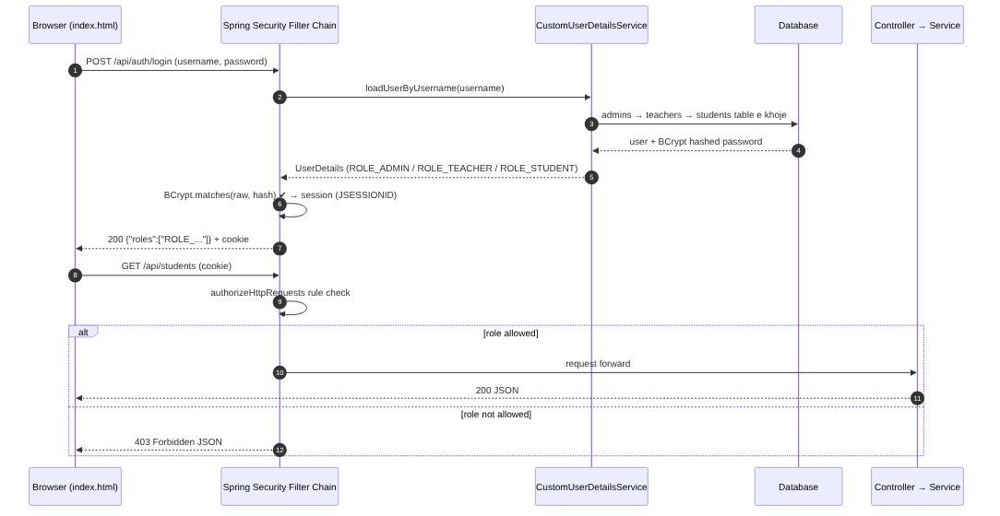
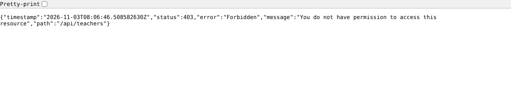
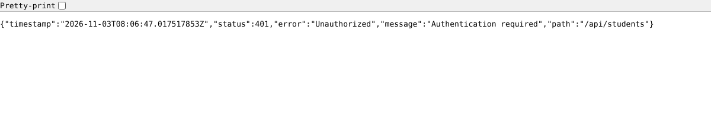
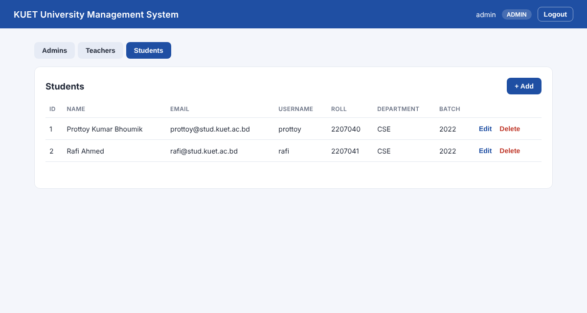
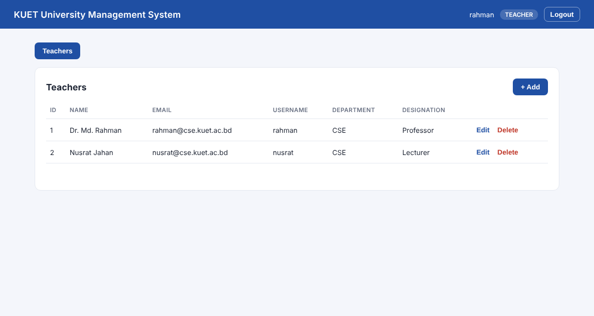
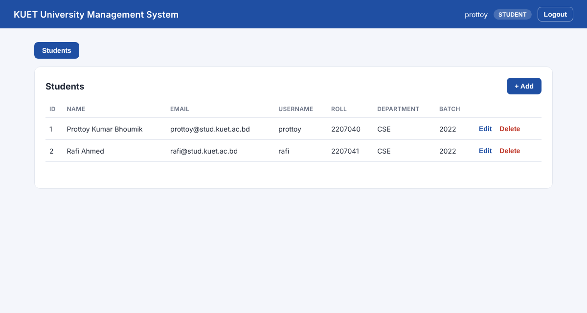
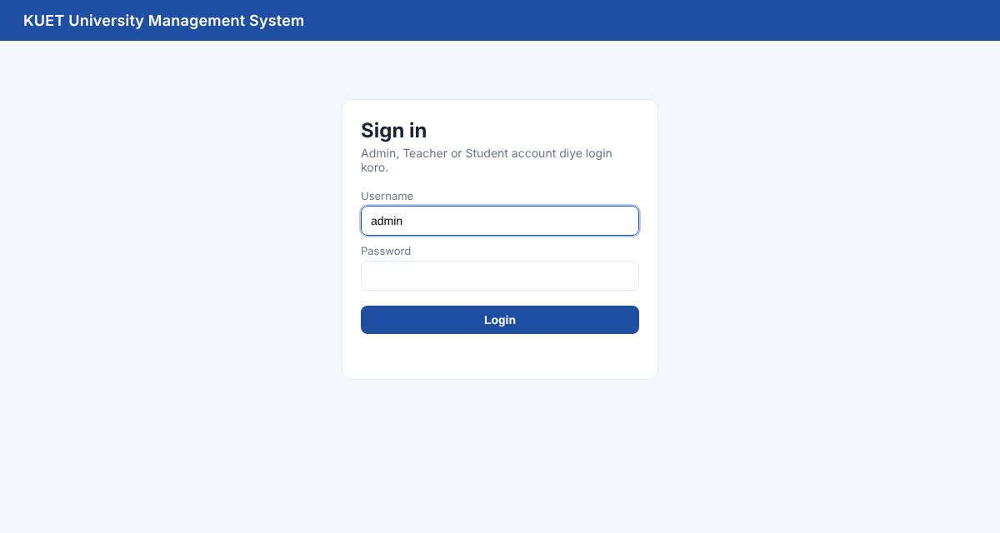
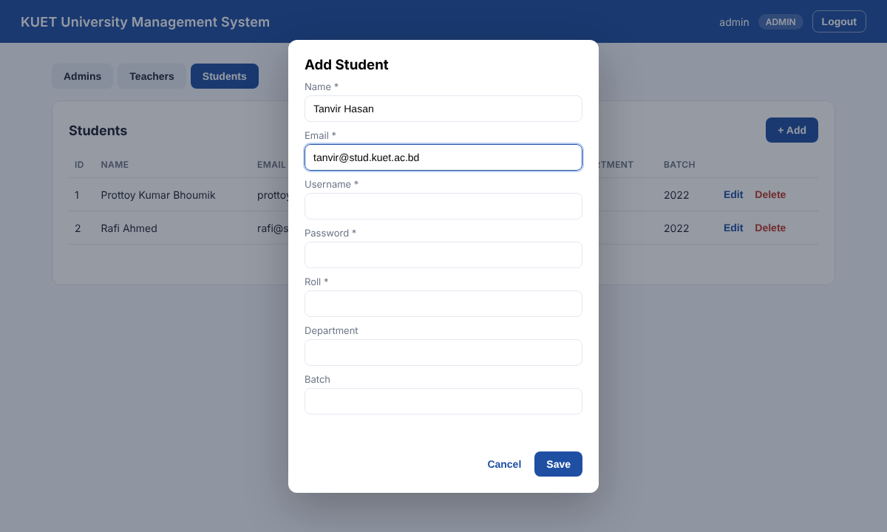
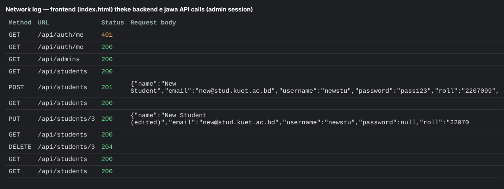

# University Management System — Viva / Demo Guide

**CSE 3230 · Lab 4 Home Task** · 

Spring Boot 3 · Spring Security · JPA · H2 (dev) / PostgreSQL (Docker) · Plain HTML + JS frontend

---

## 0. Quick demo checklist (instructor er shamne)

1. IntelliJ e `UmsApplication` → ▶ Run (ba `mvnw.cmd spring-boot:run`)
2. Browser e **http://localhost:8081** khulo
3. Login: `admin` / `admin123` → Admins, Teachers, Students teen ta tab dekhabe
4. Students tab → **+ Add** → student banao (username/password dao)
5. Logout → oi student hishebe login → shudhu **Students** tab
6. Browser e `http://localhost:8081/api/teachers` → **403 Forbidden** (RBAC proof)
7. F12 → **Network** tab → Add/Edit/Delete korle API call gula live dekhabe

| Role    | Username  | Password   | Ki dekhte/manage korte pare |
|---------|-----------|------------|-----------------------------|
| ADMIN   | `admin`   | `admin123` | Admins, Teachers, Students  |
| TEACHER | (admin create korbe) | — | Shudhu Teachers |
| STUDENT | (admin create korbe) | — | Shudhu Students |

---

## 1. Project structure (kon file e ki)

```
src/main/java/com/kuet/ums
├── entity/        BaseUser (common: id, name, email, username, password), Admin, Teacher, Student, Role
├── repository/    AdminRepository, TeacherRepository, StudentRepository  (Spring Data JPA)
├── dto/           *Request (input + validation), *Response (output, password chara)
├── service/       business logic + BCrypt hashing + duplicate check
├── controller/    AdminController, TeacherController, StudentController, AuthController
├── security/      SecurityConfig  ← authentication + authorization ekhane
│                  CustomUserDetailsService  ← login er shomoy user DB theke load
│                  DataSeeder  ← prothom bar default admin banay
└── exception/     GlobalExceptionHandler → shob error ekoi JSON format e

src/main/resources
├── static/index.html          ← FRONTEND (HTML + CSS + JavaScript, ekta file)
├── application.yml            ← common config, port 8081, default profile "dev"
├── application-dev.yml        ← H2 in-memory DB
└── application-postgres.yml   ← PostgreSQL (Docker Compose e use hoy)

Dockerfile, compose.yaml, .env ← Dockerization
```

---

## 2. ❓ "Authentication ar Authorization kothay korsen? Kivabe kon role ke authorize korse?"

### Short answer (bole dite paro)

> Authentication ar authorization duitai **`security/SecurityConfig.java`** e kora.
> Login er shomoy Spring Security **`CustomUserDetailsService`** diye username diye
> admins → teachers → students table e user khoje, tar **BCrypt hashed password** er sathe
> match kore, ar user er table onujayi role dey (`ROLE_ADMIN` / `ROLE_TEACHER` / `ROLE_STUDENT`).
> Tarpor prottek request e `authorizeHttpRequests` er URL rule diye check kore — permission
> na thakle Controller porjonto jaoar agei **403** dey.

### Pura flow ek nojore



### 2.1 Authentication (tumi ke?) — 3 ta jinish

**(a) Password hashing — `SecurityConfig.java` line 32**

```java
@Bean
public PasswordEncoder passwordEncoder() {
    return new BCryptPasswordEncoder();
}
```

User create korar shomoy service e hash kore save hoy (`StudentService.java` line 50, Teacher/Admin e o same):

```java
e.setPassword(passwordEncoder.encode(req.password()));   // BCrypt hashing
```

→ Database e plain password **kokhono** thake na, `$2a$10$...` type hash thake. Response DTO te password field-i nai.

**(b) User load + role assign — `CustomUserDetailsService.java` line 29–37**

```java
BaseUser user = adminRepo.findByUsername(username).<BaseUser>map(x -> x)
        .or(() -> teacherRepo.findByUsername(username).map(x -> x))
        .or(() -> studentRepo.findByUsername(username).map(x -> x))
        .orElseThrow(() -> new UsernameNotFoundException("User not found: " + username));

return User.withUsername(user.getUsername())
        .password(user.getPassword())          // already BCrypt hashed
        .roles(user.getRole().name())          // ROLE_ADMIN / ROLE_TEACHER / ROLE_STUDENT
        .build();
```

- Role ta **kon table e user ache** tar upor depend kore: `Admin.getRole()` → `ADMIN`, `Teacher` → `TEACHER`, `Student` → `STUDENT`.
- `.roles("ADMIN")` dile Spring nijei `ROLE_` prefix lagiye `ROLE_ADMIN` authority banay.
- Username puro system e unique rakha hoyeche (`AccountValidator`), tai ek username duita role e thakte pare na.

**(c) Login / Logout endpoint — `SecurityConfig.java` line 48–71**

```java
.formLogin(form -> form
    .loginProcessingUrl("/api/auth/login")      // POST username + password
    .successHandler(...)                        // 200 + {"username", "roles"} JSON
    .failureHandler(...))                       // 401 JSON
.logout(logout -> logout
    .logoutUrl("/api/auth/logout")
    .invalidateHttpSession(true)
    .deleteCookies("JSESSIONID"))
.httpBasic(Customizer.withDefaults())            // Postman er jonno Basic Auth o kaj kore
```

Login successful hole server **session** banay ar browser ke `JSESSIONID` cookie dey. Porer shob request e browser oi cookie pathay, tai bar bar password lage na.

### 2.2 Authorization (tumi ki korte parbe?) — RBAC

**`SecurityConfig.java` line 40–46 — main RBAC rule eita:**

```java
.authorizeHttpRequests(auth -> auth
    .requestMatchers("/", "/index.html", "/favicon.ico", "/api/auth/login", "/error").permitAll()
    .requestMatchers("/api/admins/**").hasRole("ADMIN")
    .requestMatchers("/api/teachers/**").hasAnyRole("ADMIN", "TEACHER")
    .requestMatchers("/api/students/**").hasAnyRole("ADMIN", "STUDENT")
    .anyRequest().authenticated()
)
```

| URL                | ADMIN | TEACHER | STUDENT | Teacher er instruction                 |
|--------------------|:-----:|:-------:|:-------:|----------------------------------------|
| `/api/admins/**`   | ✅    | ❌ 403  | ❌ 403  | Admin shob manage korte pare           |
| `/api/teachers/**` | ✅    | ✅      | ❌ 403  | Teacher shudhu teachers manage korbe   |
| `/api/students/**` | ✅    | ❌ 403  | ✅      | Student shudhu students manage korbe   |

- `/**` mane GET, POST, PUT, DELETE shob method e ei rule kaj kore.
- Ei check **filter chain e** hoy, Controller e jaoar **age**. Tai permission na thakle Controller er code run-i hoy na.

**Error response — `SecurityConfig.java` line 73–80**

| Situation                          | Handler                      | Status |
|------------------------------------|------------------------------|--------|
| Login na kore protected URL        | `authenticationEntryPoint`   | **401 Unauthorized** |
| Login kora, kintu role match kore na | `accessDeniedHandler`      | **403 Forbidden** |

**Proof — Student login kore `/api/teachers` e gele:**



**Proof — login chara `/api/students` e gele:**



### 2.3 UI te RBAC er effect

Same app, role onujayi alada tab:

| ADMIN | TEACHER | STUDENT |
|---|---|---|
|  |  |  |

> ⚠️ **Important point (instructor dhorte pare):** Frontend e tab lukano shudhu UI convenience.
> **Asol security backend e** (`SecurityConfig`). Keu browser theke direct `/api/admins` call
> korleo server **403** dibe, upore screenshot e jemon dekhacche.

### 2.4 Possible follow-up questions

| Question | Answer |
|---|---|
| Password kivabe store hoy? | BCrypt hash (salt shoho). `passwordEncoder.encode()` service e, `matches()` Spring nijei login e kore. |
| `hasRole` ar `hasAuthority` er difference? | `hasRole("ADMIN")` automatically `ROLE_` prefix lagiye `ROLE_ADMIN` check kore. `hasAuthority` e pura nam dite hoy. |
| 401 vs 403? | 401 = tumi ke jani na (login koro). 403 = tumi ke jani, kintu permission nai. |
| CSRF off keno? | Eta REST API, JSON client (Postman / fetch) use kore. Production e cookie-based session thakle CSRF token ba JWT use kora uchit. |
| Default admin kotha theke? | `DataSeeder` (CommandLineRunner). DB te kono admin na thakle `admin/admin123` banay (`.env` theke change kora jay). |
| Session na token? | Session (`JSESSIONID` cookie). Postman er jonno HTTP Basic o on ache. |

---

## 3. ❓ "Eita frontend e kivabe call hoise? (view e jeye dekhan)"

### Short answer

> Frontend ta **`src/main/resources/static/index.html`**, Spring Boot nijei serve kore
> (`http://localhost:8081/`). Ete JavaScript er **`fetch()`** diye REST API call hoy.
> Login er por browser `JSESSIONID` cookie rakhe, protita `fetch` e
> `credentials: 'same-origin'` thakay cookie automatically jay. Server JSON pathay, JS seta
> diye table banay.

### 3.1 Login screen



**`index.html` line 124 — `login()` function:**

```javascript
const res = await fetch('/api/auth/login', {
  method: 'POST',
  headers: { 'Content-Type': 'application/x-www-form-urlencoded' },
  body: new URLSearchParams({ username: $('u').value, password: $('p').value })
});
if (!res.ok) { $('loginMsg').textContent = 'Invalid username or password'; return; }
await boot();
```

**`index.html` line 143 — `boot()`: role dekhe tab banay**

```javascript
me = await api('GET', '/api/auth/me');            // {"username":"admin","roles":["ROLE_ADMIN"]}
const allowed = Object.keys(RESOURCES)
  .filter(k => RESOURCES[k].roles.some(r => me.roles.includes(r)));
```

`RESOURCES` (line 95) e backend er RBAC er motoi role list deya:

```javascript
admins:   { roles: ['ROLE_ADMIN'] },
teachers: { roles: ['ROLE_ADMIN', 'ROLE_TEACHER'] },
students: { roles: ['ROLE_ADMIN', 'ROLE_STUDENT'] },
```

### 3.2 Shob API call ekta helper diye — `api()` (line 109)

```javascript
async function api(method, url, body) {
  const res = await fetch(url, {
    method, credentials: 'same-origin',                 // session cookie pathay
    headers: body ? { 'Content-Type': 'application/json' } : {},
    body: body ? JSON.stringify(body) : undefined
  });
  ...
  if (!res.ok) throw new Error(`${res.status} ${data.message}`);   // 400/403/404/409 dekhay
  return data;
}
```

### 3.3 Kon button e kon API

| UI action | JS function (index.html) | HTTP call | Backend method |
|---|---|---|---|
| Login button | `login()` L124 | `POST /api/auth/login` | Spring Security formLogin |
| Page load | `boot()` L143 | `GET /api/auth/me` | `AuthController.me()` |
| Tab click (list) | `show()` L155 | `GET /api/{resource}` | `StudentController.getAll()` |
| **+ Add** → Save | `save()` L185 | `POST /api/{resource}` | `create()` → **201** |
| **Edit** → Save | `save()` L185 | `PUT /api/{resource}/{id}` | `update()` → **200** |
| **Delete** | `removeRow()` L199 | `DELETE /api/{resource}/{id}` | `delete()` → **204** |
| Logout | `logout()` L136 | `POST /api/auth/logout` | Spring Security logout |



### 3.4 Live dekhano (F12 → Network)

1. Browser e **F12** → **Network** tab → filter e `api` likho
2. Ekta student **Add**, **Edit**, **Delete** koro
3. Request e click → **Payload** (pathano JSON) ar **Response** (server er JSON) dekhao

Admin hishebe Add → Edit → Delete korle ei request gula jay:



Prothom `GET /api/auth/me` → **401**, karon tokhono login kora hoyni. Eta-i login screen dekhanor signal.

### 3.5 Request er pura path (ekta example: student add)

```
[Browser] + Add → save()
   └─ fetch POST /api/students  {name, email, username, password, roll, ...}  + JSESSIONID cookie
        ↓
[SecurityConfig] session theke user = admin, ROLE_ADMIN → /api/students/** allowed ✔
        ↓
[StudentController.create()]  @Valid @RequestBody StudentRequest  → validation fail hole 400
        ↓
[StudentService.create()]  duplicate check (409) → BCrypt hash → repository.save()
        ↓
[StudentRepository → DB]
        ↓
201 Created + Location: /api/students/3 + StudentResponse JSON (password chara)
        ↓
[Browser] show('students') → table refresh
```

---

## 4. REST API summary

| Method | URL                    | Success                  | Possible errors |
|--------|------------------------|--------------------------|-----------------|
| GET    | `/api/{resource}`      | 200 OK                   | 401, 403        |
| GET    | `/api/{resource}/{id}` | 200 OK                   | 404             |
| POST   | `/api/{resource}`      | 201 Created + `Location` | 400, 409        |
| PUT    | `/api/{resource}/{id}` | 200 OK                   | 400, 404, 409   |
| DELETE | `/api/{resource}/{id}` | 204 No Content           | 404             |

`{resource}` = `admins` / `teachers` / `students`. Error response format (`GlobalExceptionHandler`):

```json
{ "timestamp": "...", "status": 409, "error": "Conflict",
  "message": "Username 'prottoy' is already taken", "path": "/api/students", "fieldErrors": null }
```

---

## 5. Docker

```bash
docker compose up --build
```

- `Dockerfile`: multi-stage. Stage 1 e Maven diye jar build, stage 2 e shudhu JRE + jar (image choto hoy).
- `compose.yaml`: `postgres` + `app` duita service. `app` `SPRING_PROFILES_ACTIVE=postgres` diye chole, ar postgres er **healthcheck** pass korle tarpor start hoy (`depends_on: condition: service_healthy`).
- DB credentials ar default admin `.env` file theke ashe.
- App → http://localhost:8081

---

## 6. Tests

`src/test/java/com/kuet/ums/UmsApplicationTests.java` — 4 ta integration test (H2 te chole):
- login chara 401, wrong password 401
- admin CRUD: 201 / 200 / 204 / 404, duplicate 409, validation 400
- teacher → students/admins 403, student → teachers 403
- form login → `/me` → logout
